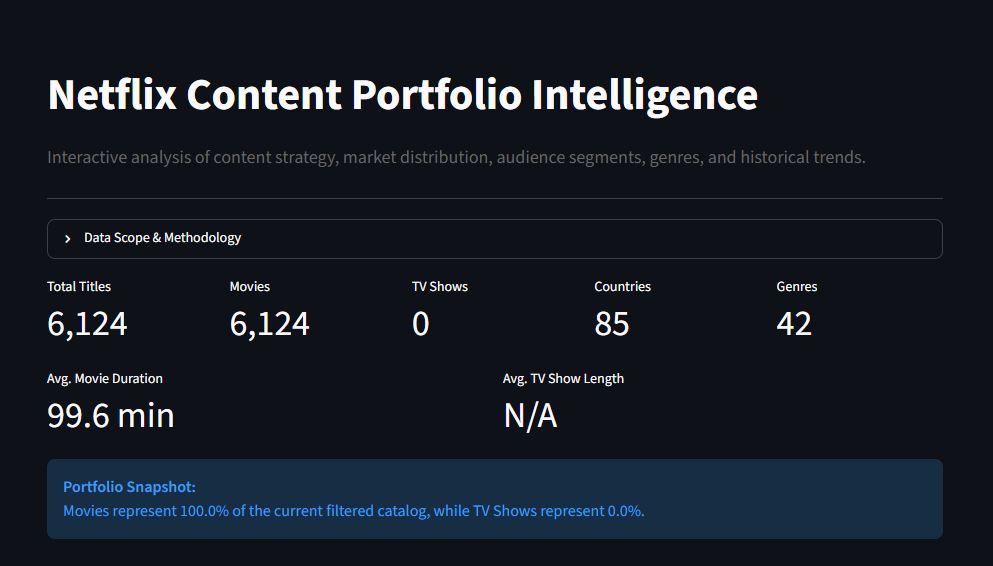

# Netflix Content Portfolio Intelligence

An end-to-end data analysis project built with Python and Streamlit to explore Netflix content strategy, market distribution, audience segments, genres, historical trends, and content characteristics.

## Project Objective

The goal of this project is to transform a raw Netflix catalog dataset into a structured analytical product that can support content portfolio analysis.

The project focuses on:

- Data quality and preparation
- Content mix analysis
- Geographic market analysis
- Historical trends
- Audience segmentation
- Genre analysis
- Movie duration and TV show season analysis
- Content age analysis
- Interactive dashboarding
- Business-oriented insights

## Business Questions

This project was designed to answer questions such as:

- What is the overall balance between Movies and TV Shows?
- Which countries contribute the most content?
- How does the Movie vs TV Show mix differ across markets?
- How has content evolved over time?
- When was content added to Netflix relative to its release year?
- Which audience groups dominate the catalog?
- Which genres are most represented?
- How do genre patterns differ between Movies and TV Shows?
- What is the typical movie duration?
- How many seasons do most TV Shows have?
- How does audience mix vary across major markets?

## Dataset

The raw dataset contains:

- 8,790 records
- 10 original columns

Main fields include:

- `show_id`
- `type`
- `title`
- `director`
- `country`
- `date_added`
- `release_year`
- `rating`
- `duration`
- `listed_in`

### Dataset Scope

This project uses a historical Netflix catalog dataset covering:

- Release years: 1925–2021
- Netflix addition years: 2008–2021

The dataset should not be interpreted as the current Netflix catalog.

## Data Quality Audit

The dataset initially appeared to contain no missing values when checked using standard null detection.

However, deeper inspection identified semantic missing values stored as text:

- 2,588 missing directors represented as `Not Given`
- 287 missing countries represented as `Not Given`

The audit also identified:

- 0 exact duplicate rows
- 6 rows representing 3 duplicated content records with different `show_id` values

After removing business duplicates:

- Final cleaned records: 8,787

## Data Cleaning & Preparation

The preprocessing pipeline includes:

- Duplicate detection and removal
- Datetime conversion
- Semantic missing-value handling
- Duration parsing
- Content age calculation
- Genre extraction
- Audience segmentation
- Feature engineering
- Final validation

### Engineered Features

Additional analytical features were created:

- `year_added`
- `month_added`
- `duration_value`
- `duration_unit`
- `content_age_at_addition`
- `content_age_valid`
- `director_clean`
- `country_clean`
- `audience_group`
- `content_age_group`

A separate exploded genre dataset was also generated for accurate genre-level analysis.

## Data Validation

The final processed dataset contains:

- 8,787 unique content records
- No duplicate `show_id`
- Valid date conversions
- Structured duration values
- 42 unique genres

Fourteen records contained negative content-age values because their release year was later than their Netflix addition year.

These records were preserved in the source data but excluded from content-age analysis rather than being modified without evidence.

## Key Findings

### Content Mix

Movies represent approximately 69.7% of the cleaned catalog, while TV Shows represent approximately 30.3%.

### Market Distribution

The United States is the largest represented market in the dataset.

Top markets include:

- United States
- India
- United Kingdom
- Pakistan
- Canada
- Japan
- South Korea
- France
- Spain
- Mexico

Content strategy differs significantly across markets.

Examples:

- India is strongly Movie-oriented
- Pakistan is strongly TV-oriented
- South Korea is strongly TV-oriented
- Japan also has a majority TV Show mix

### Audience Segmentation

Analytical audience groups were derived from content ratings.

The largest audience segments are:

- Mature
- Teens
- Teens & Family
- Kids
- Family
- Unrated

Mature content is the largest segment overall.

The audience groups used in this project are analytical categories created for this analysis and are not official Netflix audience classifications.

### Genre Analysis

The most represented genres include:

- International Movies
- Dramas
- Comedies
- International TV Shows
- Documentaries
- Action & Adventure

Movie and TV Show genre patterns differ substantially.

Movies are heavily represented by:

- International Movies
- Dramas
- Comedies

TV Shows show stronger representation in:

- International TV Shows
- TV Dramas
- TV Comedies
- Crime TV Shows
- Kids' TV

### Movie Duration

Average movie duration is approximately:

- 99.6 minutes

Median movie duration:

- 98 minutes

Most movies cluster around typical feature-film lengths, with a smaller number of very short and very long outliers.

### TV Show Seasons

Average TV Show length:

- Approximately 1.75 seasons

Median:

- 1 season

Most TV Shows in the dataset contain one or two seasons.

### Content Age

Approximately 63% of titles were added to Netflix within two years of their release.

Content-age distribution:

- Same Year: 36.90%
- 1–2 Years: 26.17%
- 3–5 Years: 12.73%
- 6–10 Years: 10.46%
- 10+ Years: 13.74%

This suggests that the catalog contains a strong concentration of relatively recent content while still maintaining a meaningful long-tail of older titles.

## Interactive Dashboard

The Streamlit dashboard provides:

- Executive KPI cards
- Content-type analysis
- Top market analysis
- Movie vs TV Show market comparison
- Release-year trends
- Netflix addition trends
- Audience analysis
- Genre analysis
- Movie duration analysis
- TV Show season analysis
- Content-age analysis
- Market audience heatmap
- Dynamic business insights
- Interactive filters
- Filtered data exploration
- CSV download

### Dashboard Filters

Users can filter by:

- Content Type
- Country
- Audience Group
- Release Year

All major KPIs, charts, and insights update dynamically based on the selected filters.

## Project Structure

```text
Netflix-Content-Portfolio-Intelligence/
│
├── data/
│   ├── raw/
│   │   └── Dataset.csv
│   │
│   └── processed/
│       ├── netflix_cleaned.csv
│       └── netflix_genres.csv
│
├── notebooks/
│   └── 01_data_audit_cleaning.ipynb
│
├── dashboards/
│   └── app.py
│
└── README.md
## Technologies Used

- Python
- Pandas
- NumPy
- Matplotlib
- Seaborn
- Plotly
- Streamlit
- Jupyter Notebook

## Run the Project

Install the required packages:

```bash
python -m pip install pandas numpy matplotlib seaborn plotly streamlit
Run the dashboard:

```bash
python -m streamlit run dashboards/app.py
Limitations
This analysis is based on catalog metadata only.
The dataset does not contain:
- Viewing behavior
- Watch time
- Revenue
- Subscriber counts
- Completion rates
- Content cost
- Licensing cost
- User demographics
- Recommendation data
Therefore, this project analyzes catalog structure and content strategy patterns, but it cannot directly measure content performance, profitability, or actual viewer behavior.